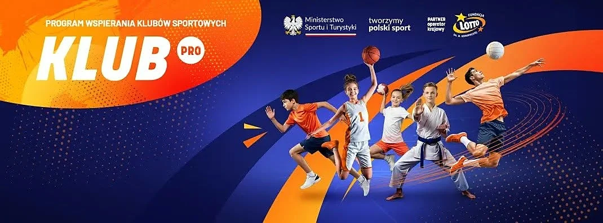

# Programy wsparcia

Szkolenie młodych koszykarzy wspierają nie tylko nasz sponsor i partnerzy, ale też programy publiczne. Tutaj przedstawiamy programy, z których korzysta nasz Klub.

## :material-trophy-outline: KLUB PRO { #klub-pro }

{ .lks-kp-banner .no-lightbox width="1070" height="398" }

**Program wspierania klubów sportowych KLUB PRO** to program Ministerstwa Sportu i Turystyki dla klubów, które najlepiej szkolą dzieci i młodzież. O tym, kto trafia do programu, decydują wyniki zawodników w Systemie Sportu Młodzieżowego (ogólnopolskiej klasyfikacji szkolenia młodzieży) oraz liczba młodych sportowców, którzy biorą udział w rywalizacji. ŁKS Koszykówka Męska jest na liście klubów zakwalifikowanych do programu w 2026 roku.

Celem programu jest zapewnienie zawodnikom jak najlepszych warunków szkolenia, tak żeby mogli w pełni rozwinąć swój talent, a w przyszłości odnosić sukcesy w sporcie seniorskim.

### Jak program pomaga naszemu Klubowi

Dofinansowanie z programu wspiera codzienne szkolenie naszych drużyn młodzieżowych. Program pozwala przeznaczyć środki m.in. na:

-   :material-stadium-outline: **Hale treningowe**

    Wynajem obiektów, w których odbywają się treningi.

-   :material-trophy-variant-outline: **Zawody i zgrupowania**

    Udział zawodników w zawodach i zgrupowaniach sportowych.

-   :material-basketball: **Sprzęt sportowy**

    Sprzęt potrzebny do treningów i meczów.

-   :material-whistle-outline: **Kadra szkoleniowa**

    Praca trenerów i specjalistów, którzy dbają o rozwój zawodników.

### Źródła finansowania

Środki finansowe przeznaczone na dofinansowanie działań związanych ze wsparciem szkolenia sportowego pochodzą z Ministerstwa Sportu i Turystyki z „Programu wspierania klubów sportowych KLUB PRO” oraz ze środków własnych Fundacji LOTTO im. Haliny Konopackiej, która jest operatorem krajowym zadania.

-   :material-bank-outline: **Ministerstwo Sportu i Turystyki**

    Organizator programu.

    [:material-open-in-new: gov.pl/web/sport](https://www.gov.pl/web/sport){ target=_blank rel="noopener" }

-   :material-star-outline: **Fundacja LOTTO im. Haliny Konopackiej**

    Operator krajowy programu.

    [:material-open-in-new: KLUB PRO na stronie Fundacji](https://www.fundacjalotto.pl/klub-pro/){ target=_blank rel="noopener" }

### Zdjęcia z treningów { #klub-pro-zdjecia }

  
  
  
  
  
  
  
  
  

[Nasze drużyny](druzyny/index.md){ .md-button .md-button--primary }
[Dołącz do naszego Klubu](dolacz.md){ .md-button }
